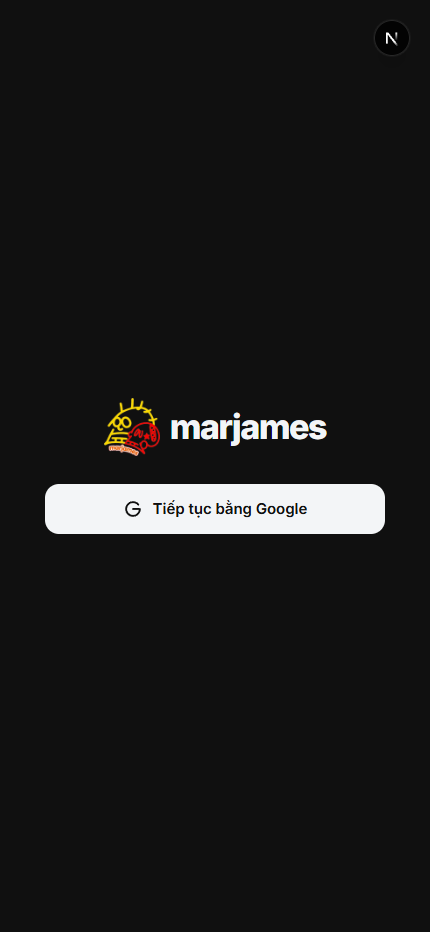

# marjames — Cortis Fandom Social Web

> Private, mobile-first Threads-style social community built exclusively for the **Cortis** fandom, capped at **1,000 members**.

[](https://nextjs.org/)
[](https://react.dev/)
[](https://bun.sh/)
[](https://prisma.io/)
[](https://www.better-auth.com/)

---

## Preview

| Feed | Post & Comments | Profile | Search | Login |
| :---: | :---: | :---: | :---: | :---: |
|  |  |  |  |  |

---

## Features

- **Private Fandom Gate (Max 1,000 Members)**
  - Google OAuth only via **Better Auth** (`databaseHooks.user.create.before` enforces the 1,000-member cap and optional `ADMIN_EMAIL` bootstrap).
  - Unauthenticated visitors and banned accounts are blocked at the server boundary and redirected to `/login`.
- **Mobile-First Threads UX**
  - Sticky top header, bottom navigation on mobile, and a centered `620px` feed column with left sidebar on desktop.
  - **Dark theme** and **Vietnamese (`vi`)** enabled by default, with user preferences (`dark`/`light`, `vi`/`en`) persisted in PostgreSQL (`user_setting`).
- **Posts & Media Optimization**
  - Text posts up to 500 chars with up to **5 images** and **1 video** per post.
  - Images: originals upload untouched when `jpeg/png/webp` and ≤ 4 MB; larger or other formats are re-encoded client-side (1600px WebP q0.95), then `/api/upload` does at most one `sharp` pass (1600px WebP q88, only when oversized or above 2 MB) before streaming to **Cloudinary**. Video goes straight to **Cloudflare R2** with a presigned `PUT` (MP4/MOV, H.264 only, ≤ 60 s, ≤ 50 MB).
  - **For You** and **Following** feeds powered by cursor pagination and TanStack Query.
- **Engagement & 2-Level Comments**
  - Instagram-style **Heart** likes on both **posts** and **comments** (no public dislikes).
  - Strict **2-level comment threads**: replying to any level-1 or level-2 comment auto-prefills `@username` in the input (YouTube-style), renders clickable blue `@username` profile links, and keeps `parentId` at level 1.
- **Search & Profiles**
  - Search members (`@username`) and posts with URL-synced query params (`/search?q=...&filter=top|recent`), **Top / Recent** sorting, and 10-item local search history (users & keywords).
  - User profiles (`/u/[username]`) with follow/unfollow, bio, avatar upload, and a 30-day username change cooldown.
- **Moderation & Admin Dashboard (`/admin`)**
  - Desktop-only (`≥ 1024px`) moderation panel with stats overview, post/comment deletion, user ban/unban (admins protected), and report resolution.
- **Supabase Keep-Alive**
  - `/api/health` runs a real DB query (`prisma.user.count()`), pinged automatically by **Vercel Cron** (`vercel.json`) and **GitHub Actions** (`.github/workflows/keep-alive.yml`) to prevent Supabase free-tier auto-pause.

---

## Tech Stack

| Layer | Technology |
| :--- | :--- |
| **Runtime & Package Manager** | Bun `1.4.4` |
| **Framework** | Next.js `16.4.6` (App Router, Turbopack), React `19.3`, TypeScript `5` |
| **Styling & Icons** | CSS Tokens (Dark/Light), Tailwind CSS `4.3.3`, Phosphor Icons, Sonner |
| **Data Fetching** | TanStack Query `5.107.1` |
| **Authentication** | Better Auth `1.7.23` (Google OAuth + Prisma Adapter) |
| **Database & ORM** | PostgreSQL (Supabase) + Prisma `7.10.1` (`@prisma/adapter-pg`) |
| **Media** | Cloudinary `2.11.0` + `sharp` `0.35.5` (images); Cloudflare R2 with presigned uploads (video) |
| **Hosting** | Vercel |

---

## Project Structure

```text
├── prisma/
│   └── schema.prisma              # User, UserSetting, Session, Account, Post, Comment, Like, CommentLike, Follow, Report
├── src/
│   ├── app/
│   │   ├── api/                   # REST endpoints (auth, posts, comments, likes, search, users, admin, upload, health)
│   │   ├── admin/                 # Desktop admin dashboard
│   │   ├── compose/               # Post composer
│   │   ├── login/                 # Google OAuth gate
│   │   ├── post/[id]/             # Post detail & 2-level comments
│   │   ├── search/                # Member & post search (Top / Recent)
│   │   ├── settings/profile/      # Profile editor
│   │   └── u/[username]/          # Member profile
│   ├── components/                # UI shell, cards, modals, skeletons
│   ├── hooks/                     # Feed & post-detail mutations
│   ├── lib/                       # Constants, i18n, image compression, client error helpers
│   ├── server/                    # Auth config, Prisma client, session guards, Cloudinary, post mapper
│   └── types/                     # Shared DTO contracts
├── .github/workflows/keep-alive.yml
└── vercel.json
```

---

## Getting Started

### 1. Prerequisites

- [Bun](https://bun.sh/) `>= 1.4`
- A [Supabase](https://supabase.com/) PostgreSQL project
- A [Google Cloud Console](https://console.cloud.google.com/) OAuth 2.0 Web Client (`<APP_URL>/api/auth/callback/google`)
- A [Cloudinary](https://cloudinary.com/) account
- A [Cloudflare](https://dash.cloudflare.com/) account with an **R2** bucket, a public **custom domain** (never an `r2.dev` URL), and a **CORS policy allowing `PUT` + `content-type`** from the app origins — without CORS the browser video upload fails as a generic network error

### 2. Environment Variables

Copy `.env.example` to `.env` and fill in your credentials:

```bash
cp .env.example .env
```

| Variable | Description |
| :--- | :--- |
| `DATABASE_URL` | Supabase Transaction Pooler URL (`:6543/postgres?pgbouncer=true`) |
| `DIRECT_URL` | Supabase Direct Connection URL (`:5432/postgres`) for Prisma CLI |
| `BETTER_AUTH_SECRET` | Random secret (`>= 32` chars, e.g. `openssl rand -base64 32`) |
| `BETTER_AUTH_URL` | Public app URL (`http://localhost:3000` locally) |
| `GOOGLE_CLIENT_ID` | Google OAuth Client ID |
| `GOOGLE_CLIENT_SECRET` | Google OAuth Client Secret |
| `ADMIN_EMAIL` | Comma-separated emails auto-promoted to `admin` on first sign-up |
| `NEXT_PUBLIC_CLOUDINARY_CLOUD_NAME` | Cloudinary cloud name |
| `CLOUDINARY_API_KEY` | Cloudinary API key |
| `CLOUDINARY_API_SECRET` | Cloudinary API secret |
| `R2_ACCOUNT_ID` | Cloudflare account ID (video uploads) |
| `R2_ACCESS_KEY_ID` | R2 access key ID |
| `R2_SECRET_ACCESS_KEY` | R2 secret access key |
| `R2_BUCKET` | R2 bucket name (`marjames-media`) |
| `R2_PUBLIC_BASE_URL` | Public bucket domain — https, custom domain, never `r2.dev` |

### 3. Install & Push Database Schema

```bash
bun install
set -a; . ./.env; set +a                            # export DIRECT_URL for psql
psql "$DIRECT_URL" -f prisma/sql/search-indexes.sql   # pg_trgm + GIN search indexes
bun --env-file=.env run db:push
bun --env-file=.env run db:generate
```

`prisma/sql/search-indexes.sql` must run first: the schema declares GIN trigram indexes,
which need the `pg_trgm` extension on a fresh database.

### 4. Run Locally

```bash
bun run dev
```

Open [http://localhost:3000](http://localhost:3000).

---

## Scripts

| Command | Description |
| :--- | :--- |
| `bun run dev` | Start Next.js dev server with Bun & Turbopack |
| `bun run build` | Create production build |
| `bun run start` | Start production server |
| `bun run typecheck` | Run `tsc --noEmit` |
| `bun run lint` | Run ESLint |
| `bun --env-file=.env run db:push` | Sync Prisma schema to PostgreSQL |
| `bun --env-file=.env run db:generate` | Regenerate Prisma Client |

---

## Deployment (Vercel)

1. Import the repository on [Vercel](https://vercel.com/) and configure all environment variables from `.env.example` (set `BETTER_AUTH_URL` to your production domain).
2. Add `https://<your-domain>/api/auth/callback/google` to **Authorized redirect URIs** in Google Cloud Console.
3. Add repository variable `APP_HEALTH_URL` (`https://<your-domain>/api/health`) in **GitHub Settings → Secrets and variables → Actions → Variables** so `.github/workflows/keep-alive.yml` keeps Supabase active.
