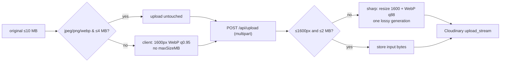

# Decision record: image compression is sharp-only

**Date:** 2026-11-16
**Status:** decided and shipped
**Supersedes:** the earlier TinyPNG/Tinify integration (built, measured, removed the same day)

## Decision

The server compresses uploads with **`sharp` only** — no third-party image API. `sharp` is a direct dependency (`^0.35.5`, same range Next.js declares), runs in-process on Vercel, and does resize+encode in a single lossy generation.

## Why Tinify/TinyPNG was removed

| Evidence | Number |
|---|---|
| Its WebP output is **lossy**, not a lossless repack (1600 px q0.85 in → out, raw RGB compared) | 7,369,151 / 7,680,000 channel samples changed, max diff 52/255 |
| Free quota | 500 compressions/month for up to 1,000 members |
| Round-trip on this uplink (JPEG 1.0 MB → 900 KB) | 8.4 s, versus 0.2–0.4 s for `sharp` |
| Gain left once originals are uploaded untouched | only images already ≤1600 px |

Any pass through it was a second lossy generation on top of the browser encode — the exact defect members reported as broken images. Keeping it also meant an env key, a 10 s timeout, a per-instance cooldown and an outage path.

## Rejected alternatives

| Library | Version | Why not |
|---|---|---|
| `tinify` npm client | 1.9.0 | API is 2 requests; client adds `https-proxy-agent` we do not need |
| `@squoosh/lib` | 0.5.3 | Dead: engines capped at Node ≤16, last publish 2023, 12 MB unpacked WASM |
| `imagemin` | 8.x | Plugin churn, slow, lossy WebP plugin unmaintained |
| `browser-image-compression` | 2.0.2 | Kept client-side only, for files above the request-body cap; its `maxSizeMB` quality loop caused the original complaint and is no longer used |

## Pipeline

Client rule lives in `prepareUploadImage` (`src/lib/compress-image.ts`): originals pass through only for `image/jpeg|png|webp` — sharp's prebuilt binaries carry no HEIC/HEVC codec — and only under `MAX_UPLOAD_BYTES`; everything else is re-encoded in the browser. The server validates by decoding, so a lying or empty `file.type` ends in 415, never in a broken asset.

Constants (`src/lib/constants.ts`): `COMPRESS_IMAGE_DIMENSION` 1600, `CLIENT_IMAGE_QUALITY` 0.95, `SERVER_IMAGE_QUALITY` 88, `MAX_UPLOAD_BYTES` 4 MB, `MAX_STORED_IMAGE_BYTES` 2 MB.

## Measurements (shipped code, local, 2026-11-16)

| Input | Result |
|---|---|
| 3000 px JPEG q92, 324 KB, photo-like content | 1600 px WebP 49.7 KB, **PSNR 44.6 dB** vs lossless resize, 407 ms |
| 3000 px noisy JPEG, 7.0 MB | 1600 px WebP 1.25 MB, 407 ms |
| 1200 px JPEG, 1.02 MB | untouched (within both ceilings) |
| Non-image bytes | `null` → HTTP 415 |

## Risks

1. **Delivered bytes are larger** than the old forced ≤0.28 MB pipeline (typically 50–600 KB per image). That is the price of detail; Cloudinary free 25 GB covers ~50k images.
2. **Two generations remain** only for originals above 4 MB or in containers sharp cannot decode (client q0.95 → server q88). Raise `CLIENT_IMAGE_QUALITY` if it ever shows.
3. **HEIC/HEVC**: the browser must transcode; if it cannot either, the member sees `errImageCompress`. Fixing that properly means rebuilding sharp with libheif.
4. **No external optimizer**: screenshots that are already ≤1600 px and ≤2 MB keep their bytes. Acceptable; lowering `MAX_STORED_IMAGE_BYTES` is the lever if storage pressure appears.

## Next steps

1. Review one real photo upload by eye before trusting the PSNR figures.
2. If storage/bandwidth grows faster than expected, lower `MAX_STORED_IMAGE_BYTES` to ~600 KB — `sharp` costs nothing per call, unlike the removed API.
